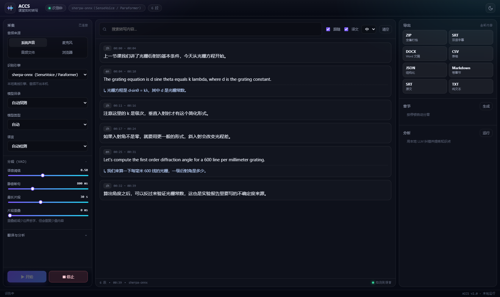

# ACCS — AI Capture Course Sound

**把讲课音频变成可检索、可交付的文字稿。**
本机实时转写 → 自动分段 → 英译中 → 一键导出（双语字幕 / Word / ZIP）。



> 全程本地运行：音频不出本机，翻译与分析走本机 Ollama。
> 唯一例外是「浏览器识别」模式——它用浏览器的 Web Speech API，可能依赖厂商在线服务，界面上会明确提示。

---

## 这一版做了什么

| 方向 | v1 | v2 |
|---|---|---|
| **分段** | 逐帧拼接、固定 800ms 静音、30s 硬切 | 预分配缓冲、双阈值滞后、能量谷切分、可配置重叠 |
| **引擎** | Whisper ×2 | 7 个：sherpa-onnx、faster-whisper、openai-whisper、FunASR、Vosk、whisper.cpp、浏览器 |
| **界面** | 单页表单 | 三栏工作台：设置 / 实时字幕 / 导出分析，深浅色、搜索、章节跳转 |
| **导出** | txt / md / srt / jsonl | + 双语 SRT、VTT、DOCX、CSV、结构化 JSON、自动分章、ZIP 打包 |
| **交付** | 源码 | 源码 + 一键脚本 + Windows exe |

## 快速开始

### 方式一：exe（推荐给同学）

1. 解压 `ACCS-windows.zip`
2. 把 `models/` 放到 `ACCS.exe` 旁边（自带模型见下）
3. 双击 `启动.bat` → 浏览器打开 <http://127.0.0.1:8000>

### 方式二：源码

```powershell
git clone https://github.com/LLYlab/ACCS.git
cd ACCS
.\setup.bat            # 建 venv + 装依赖（首次约 10 分钟）
.\启动.bat             # 或 .venv\Scripts\python -m accs.web --port 8000
```

> 需要 Python 3.9+、ffmpeg（`winget install Gyan.FFmpeg`）。

### 模型放哪

```
ACCS/
└── models/
    ├── csukuangfj/sherpa-onnx-sense-voice-zh-en-ja-ko-yue-2024-07-17/   # 推荐，228 MB
    ├── vosk-model-small-cn-0.22/                                       # 可选
    └── ggml-small.bin                                                  # whisper.cpp 用
```

界面左侧「模型目录」会自动扫描 `models/` 并列出，选「自动探测」也行。

## 四个改进点

### 1. 分段（`accs/segmenter.py`）

- **双阈值 + 滞后**：开始 0.5、结束 0.3×阈值，一句话不会被 VAD 抖动切碎
- **能量谷切分**：超过最长片段时，在能量最低处切，而不是硬切在词中间
- **前置补音 / 尾部 pad / 可选重叠**：边界字不容易丢
- **O(1) 追加**：帧列表 + 定稿时一次 concat，长片段不再 O(n²)

### 2. 引擎（`accs/transcriber.py`）

| 引擎 | 流式 | 时间戳 | 标点 | 说明 |
|---|---|---|---|---|
| sherpa-onnx | 视模型 | — | ✅ | SenseVoice / Paraformer / 流式 Zipformer，中文最佳 |
| faster-whisper | — | ✅ | ✅ | CTranslate2，实时性好 |
| openai-whisper | — | ✅ | ✅ | 复用 PyTorch |
| FunASR | — | ✅ | ✅ | 阿里达摩院 |
| Vosk | ✅ | ✅ | — | 轻量，CPU 友好 |
| whisper.cpp | — | ✅ | ✅ | GGML，低配机器 |
| 浏览器 | ✅ | — | — | Web Speech API，**可能非本地** |

界面会显示每个引擎是否已安装；未安装的会标注缺什么。

### 3. 界面（`accs/static/`）

- 三栏：采集设置 / 实时字幕 / 导出与分析
- 实时字幕：搜索、跟随、字号、双语对照、时间戳
- 右侧：导出格式网格、按停顿自动分章、LLM 纠错与知识点
- 深浅色、移动端自适应、设置持久化
- 浏览器模式会在页面内直接调用麦克风并回传结果

### 4. 导出（`accs/exporters.py`）

| 格式 | 内容 |
|---|---|
| ZIP | 下述全部打包（含 docx） |
| SRT（双语） | 原文 + 译文两行 |
| DOCX | 标题、元信息、章节、时间戳、译文 |
| CSV | 时间/时长/语言/原文/译文 |
| JSON | 结构化片段 + 章节 + 元信息 |
| MD | 带章节与引用块 |
| TXT / VTT / JSONL | 常规 |

自动分章：相邻片段间隔 > 2.5 s 视为换章节，太短的章节自动并入上一章。

## 命令行

```powershell
# 系统声音（网课/讲座）
.\.venv\Scripts\python -m accs --source system --engine sherpa_onnx

# 本地文件 + 全套导出
.\.venv\Scripts\python -m accs --source file --file lecture.m4a --output all

# 看有哪些音频设备
.\.venv\Scripts\python -m accs --list-devices
```

常用参数：`--engine`、`--model`、`--language`、`--silence-ms`、`--vad-threshold`、`--overlap-ms`、`--max-segment-ms`。

## 项目结构

```
accs/
  segmenter.py    分段器（双阈值 / 能量谷 / 重叠）
  transcriber.py  引擎层（7 个引擎 + 能力表）
  exporters.py    txt/md/srt/vtt/json/csv/docx/zip + 自动分章
  pipeline.py     采集 → 分段 → 后台转录 → 输出
  webapp.py       FastAPI + SSE + 导出/章节/分析接口
  paths.py        源码/打包两种运行方式的路径解析
  static/         三栏工作台（原生 JS，无构建）
desktop 相关：无（v2 只保留 Web UI 与 CLI）
tests/test_logic.py  10 组纯逻辑测试（分段 / 导出 / 配置）
build_exe.ps1    PyInstaller 打包
```

## 测试

```powershell
.\.venv\Scripts\python.exe -X utf8 tests\test_logic.py
```

覆盖：配置覆盖、SRT/VTT 时间格式、CLI 输出、分段（静音切分/过短丢弃/超长切分/重叠/前置补音）、导出（SRT/VTT/CSV/JSON/MD/ZIP）、自动分章。

## 常见问题

**Q：没有声音 / 抓不到系统播放？**
先确认系统正在播放、音量不为 0；Windows 上用 WASAPI 环回，部分应用需要允许共享音频。

**Q：中文识别不准？**
用 sherpa-onnx 的 SenseVoice 模型（仓库推荐），或换更大的 Whisper。`--language zh` 也能提高稳定性。

**Q：浏览器识别是离线吗？**
不一定。Chrome/Edge 的 Web Speech API 通常会把音频送到厂商服务器；要严格离线请用 sherpa-onnx / Vosk。

**Q：翻译慢？**
翻译在后台线程跑，原文先出、译文后补。R1 每次约 10–20 秒，属正常。

**Q：exe 启动慢？**
onedir 版本首次启动约 3–5 秒（加载 onnxruntime），之后正常。

## 许可

MIT
